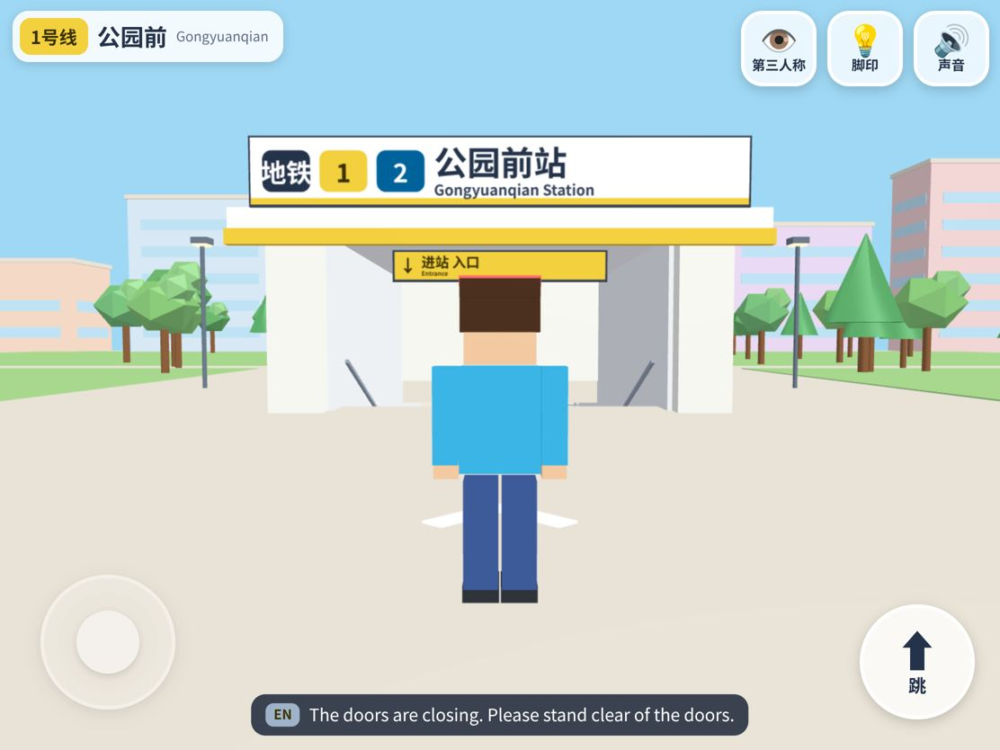
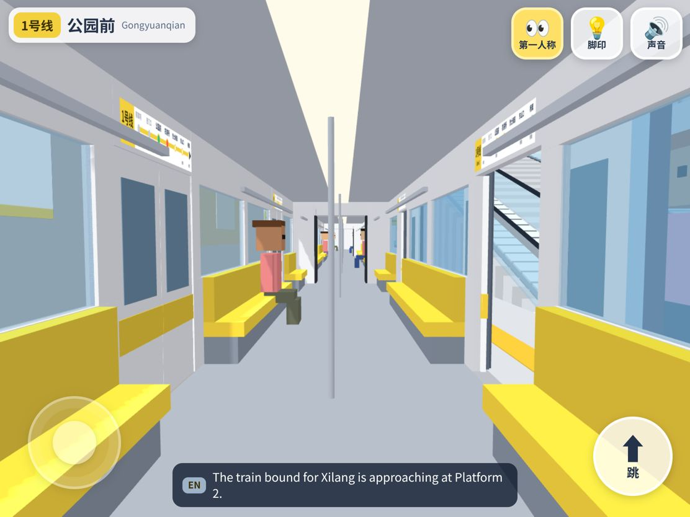
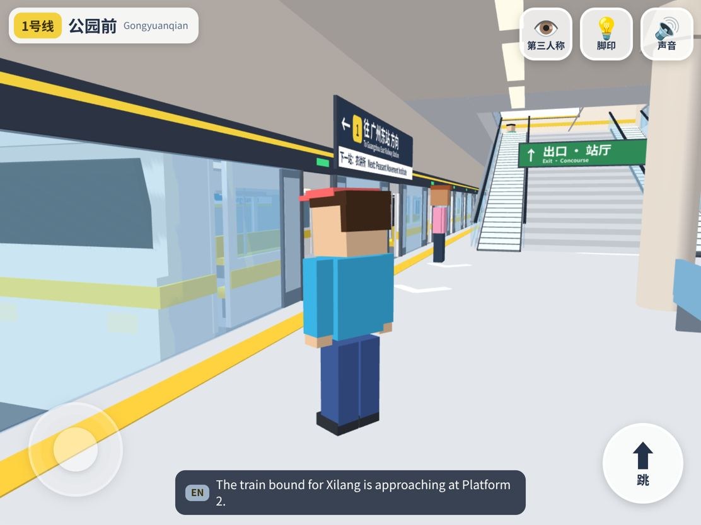
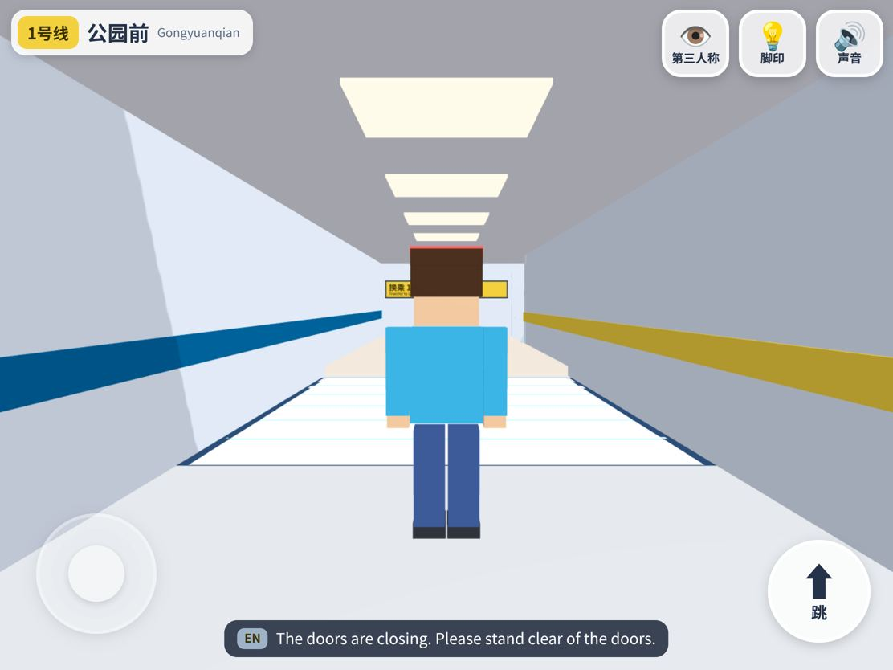
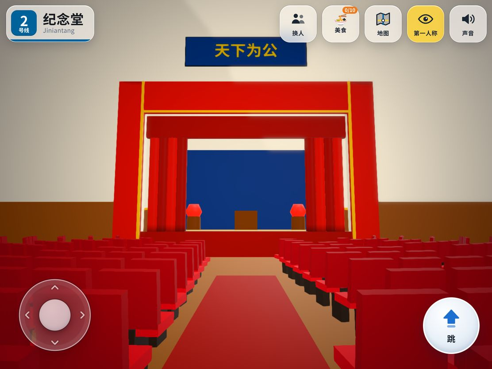
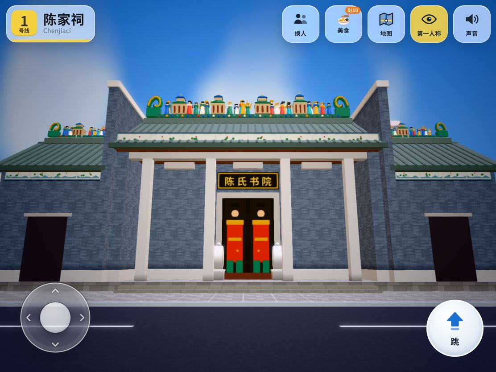
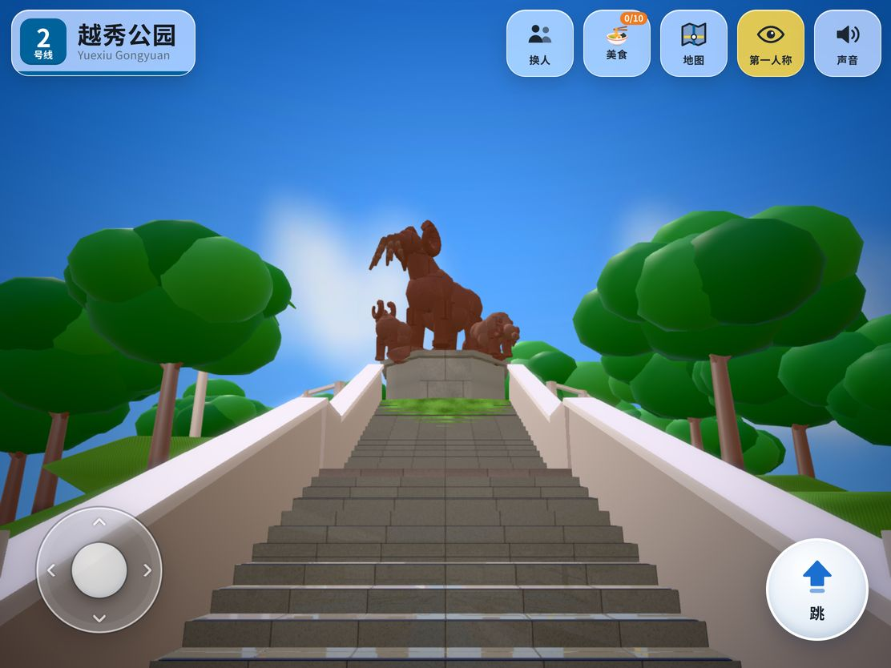
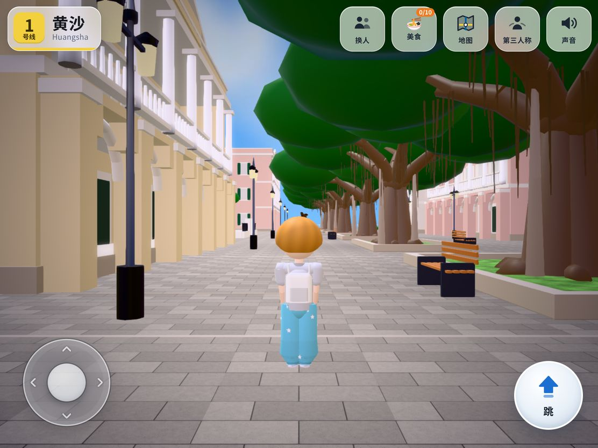
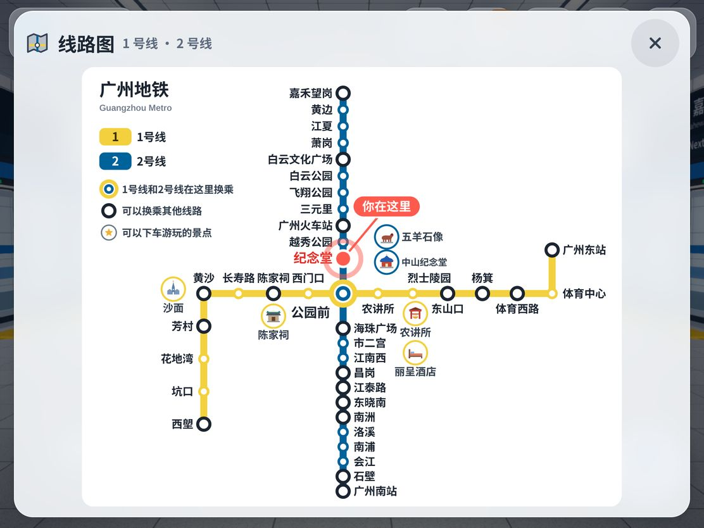

# 坐地铁 · 广州 3D 探险

一个给小朋友玩的网页 3D 小游戏：像《我的世界》那样用手指走路、转头，从广州地铁站口走进去，买票、刷闸机、等车、上车，坐着 1 号线和 2 号线去广州城里逛一逛。

打开就能玩，不用安装，在 iPad 上横屏最舒服，手机竖屏也行。

**👉 在线试玩：<https://gz-metro-bricks.pages.dev>**

<p align="center">
  
  
</p>
<p align="center">
  
  
</p>

## 这个项目的由来

2026 年国庆假期我们全家去广州玩，逛了广州地铁博物馆，里面展出了 1 号线从无到有的整个建造过程。巧的是，我们住的酒店就在 1 号线的农讲所站旁边，那几天出门几乎全靠 1 号线，坐的一直是这列漂亮的黄色地铁。我们在博物馆里把它的模型买了回来，小儿子特别喜欢。

他的这份喜欢给了我灵感：让 Claude 带着 Codex 干了几个小时，就做出了一个还不错的效果。小儿子足足玩了两天。前几天刚坐过的地铁、刚买回来的车，转眼出现在他自己专属的 iPad 里，还能亲手拼、亲自坐，他觉得非常神奇。里面有很多点子是他自己提的，我都加了进去，整个过程很有意思，所以想把它分享出来。

页面算不上精良，但对一个 8 岁的孩子来说足够有趣。硬件要求也很低，我们用的是一台很老的 iPad Air 3，运行流畅。如果你家小朋友也喜欢地铁，可以直接拿去在本地跑起来。

## 能玩什么

- **坐地铁**：1 号线、2 号线的每一站都能坐到。自己在售票机买票、过安检、刷闸机，下到站台等车。车上有普通话、粤语、英语三种报站，到了想去的站就下车。
- **选一个小朋友出发**：弟弟星星最爱坐地铁，哥哥明明最爱吃。跟着明明走，还能进店点菜、吃一口，再在美食护照上盖个章。
- **下车去逛逛**，这几站出站就能走到景点：
  - **中山纪念堂**：穿过大门、走过中轴大道，进到礼堂里找个位子坐下，看着舞台上的「天下为公」。
  - **农讲所和文明路**：红墙黄瓦的旧址，旁边就是满街骑楼的糖水街。
  - **丽呈铂锐酒店**：就在农讲所站旁边。走进大堂按电梯上三楼，进双床房在床上躺一会儿。
  - **陈家祠**：灰砖、屋脊上一排排彩色陶塑。
  - **五羊石像**：越秀公园站出来过马路，爬上石阶就到。
  - **沙面**：过小石桥，走进大榕树下的林荫道，一直走到珠江边。
- **地图**：线路图上标出了哪些站可以下车去玩，还有一个「你在这里」告诉你现在到了哪儿。
- **会跟着地方变的声音**：站台上听得到列车进站，走上街面就是车来车往，进了酒店一下子安静下来，沙面还有鸟叫。

<p align="center">
  
  
</p>
<p align="center"><sub>中山纪念堂：坐在礼堂里看「天下为公」　·　陈家祠：门前看满屋脊的彩色陶塑</sub></p>
<p align="center">
  
  
</p>
<p align="center"><sub>越秀公园：从石阶下抬头看五羊石像　·　沙面：大榕树下的林荫道</sub></p>
<p align="center">
  
  
</p>
<p align="center"><sub>线路图：哪站能下车去玩一眼就知道　·　出发前选一个小朋友：星星还是明明</sub></p>

## 怎么玩

| | iPad 触屏 | 键盘鼠标 |
| --- | --- | --- |
| 走路 / 跑 | 左半边屏幕按住拖动 | WASD / 方向键，Shift 跑 |
| 看四周 | 右半边屏幕拖动 | 点一下画面后移动鼠标 |
| 跳 | 右下角「跳」 | 空格 |
| 买票、刷卡、坐下、打招呼…… | 走近时出现的大按钮 | E |

右上角还有换人、美食护照、地图、视角和声音按钮。没有教程，随便走走就会了。

## 在自己电脑上跑

```bash
git clone https://github.com/JPlay/gz-metro-bricks.git
cd gz-metro-bricks
python3 -m http.server 8080
```

然后打开 `http://localhost:8080`。站名和线路资料来自维基百科等公开资料。

## 许可与声明

- 代码以 [MIT](./LICENSE) 许可开源。`vendor/babylonjs/` 是 Babylon.js，Apache-2.0 许可。
- `vendor/env/environmentSpecular.env`、`vendor/env/studio.env` 来自 [Babylon.js Assets](https://github.com/BabylonJS/Assets)（assets.babylonjs.com），CC BY 4.0 许可。贴图由本仓库脚本程序生成。
- 音频素材的来源和许可见 [`assets/audio/CREDITS.md`](./assets/audio/CREDITS.md)。
- 这是一个个人爱好项目，与广州地铁集团无关联；站名、线路等信息仅用于还原乘车场景。
